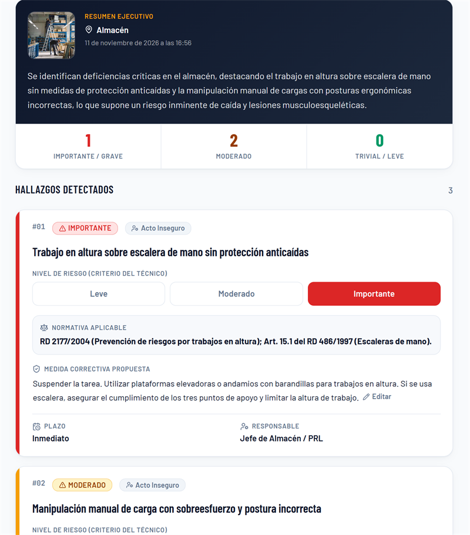

# 🛡️ PRL Vision Audit

> Asistente inteligente para evaluar riesgos en campo y generar actas técnicas en minutos.

[](https://react.dev)
[](https://www.typescriptlang.org)
[](https://n8n.io)
[](LICENSE)

🌐 **[Ver demo en vivo →](https://prl-vision-safety-audit.vercel.app)**

<!-- 🔗 Autor: sustituye esta URL por la del despliegue real en Vercel cuando esté publicado. -->

## Demo



<!-- 📸 Autor: sube tu captura o GIF a assets/demo.png y actualiza esta referencia antes de publicar el portfolio. -->

## Tabla de Contenidos

- [El Problema y la Solución](#el-problema-y-la-solución)
- [Características Principales](#características-principales)
- [Arquitectura del Sistema](#arquitectura-del-sistema)
- [Instalación y Configuración](#instalación-y-configuración)
- [Origen y Evolución](#origen-y-evolución)
- [Aviso Legal](#aviso-legal)
- [Licencia](#-licencia)

## El Problema y la Solución

Cada visita a obra o planta genera fotos, notas y observaciones que el técnico debe convertir después en un informe técnico. Ese trabajo administrativo consume horas de oficina, retrasa la entrega del acta y deja hallazgos sin la referencia normativa o el plazo de corrección.

**PRL Vision Audit** convierte una fotografía y dos campos de contexto en un borrador de evaluación de riesgos estructurado, con normativa, medidas correctivas y responsables. El técnico conserva siempre la decisión final: revisa, corrige y firma.

> **Propósito:** que los riesgos detectados en una inspección se corrijan antes de que alguien se lesione.

## Características Principales

- 🔍 **Detección visual multimodal** — identifica actos y condiciones inseguras a partir de fotografías tomadas en campo.
- ⚖️ **Criterio calibrado INSST** — clasifica los cinco niveles de la escala y los traduce a un semáforo de tres colores, evitando falsas alarmas.
- 📜 **Encuadre normativo español** — fundamenta cada hallazgo con la Ley 31/1995 y los Reales Decretos específicos aplicables.
- ✍️ **Validación por el técnico** — permite editar medidas, plazos y niveles de gravedad antes de emitir el documento.
- 📄 **Acta PDF lista para firma** — exporta informes con evidencia fotográfica incrustada, metadatos y espacios de firma.
- 🗂️ **Historial local rápido** — consulta las últimas inspecciones guardadas en el navegador, sin cuentas ni servidores intermedios.

## Arquitectura del Sistema

```text
┌──────────────────────────────────┐
│  Frontend                        │
│  React · Vite · Tailwind CSS     │
└────────────────┬─────────────────┘
                 │ Server Function (HTTPS)
                 ▼
┌──────────────────────────────────┐
│  Webhook Seguro                  │
│  validación · timeout · anti-SSRF│
└────────────────┬─────────────────┘
                 │ JSON + imagen
                 ▼
┌──────────────────────────────────┐
│  Motor n8n + IA Multimodal       │
│  criterios INSST · normativa     │
└────────────────┬─────────────────┘
                 │ informe estructurado
                 ▼
┌──────────────────────────────────┐
│  Acta PDF firmable               │
│  evidencia + hallazgos + firmas  │
└──────────────────────────────────┘
```

**Flujo:** Frontend ➔ Webhook Seguro ➔ Motor n8n + IA Multimodal ➔ Acta PDF.

## Instalación y Configuración

Requisitos: **Node.js 20 o superior** y una instancia de n8n con el flujo de análisis multimodal.

```bash
# 1. Clona el repositorio
git clone https://github.com/carladdm/prl-vision-safety-audit.git
cd prl-vision-safety-audit

# 2. Instala las dependencias
npm install

# 3. Configura las variables de entorno
cp .env.example .env

# 4. Arranca el entorno de desarrollo
npm run dev
```

> [!NOTE]
> En Windows, usa `Copy-Item .env.example .env` si `cp` no está disponible. Vite mostrará en la terminal la URL local de la aplicación.

| Variable          | Descripción                                                                                                                    | Requerido |
| :---------------- | :----------------------------------------------------------------------------------------------------------------------------- | :-------: |
| `N8N_WEBHOOK_URL` | URL completa del webhook de n8n que ejecuta el análisis multimodal. Se lee **solo en el servidor** y nunca llega al navegador. |   ✅ Sí   |

> [!NOTE]
> La variable **no lleva el prefijo `VITE_`**: ese prefijo haría que Vite incrustara la URL en el JavaScript público. Mantenerla en el servidor protege el webhook y evita problemas de CORS.

## Origen y Evolución

El primer prototipo se generó con Lovable para validar el flujo de captura y análisis. La versión actual reescribe la capa de servidor (validación, timeout y protección SSRF), corrige la escala INSST, añade pruebas automatizadas y refuerza la accesibilidad y la privacidad. El historial de commits documenta esa evolución.

## Aviso Legal

> [!IMPORTANT]
> **Herramienta de apoyo técnico.** Los informes generados son borradores asistidos y no sustituyen una evaluación de riesgos legal. La validación, corrección y firma final corresponden siempre a un **Técnico Superior en Prevención de Riesgos Laborales acreditado**.

## 📄 Licencia

Distribuido bajo la **Licencia MIT**. Consulta el archivo [LICENSE](LICENSE) para el texto completo.

© 2026 Carla Di Monno
