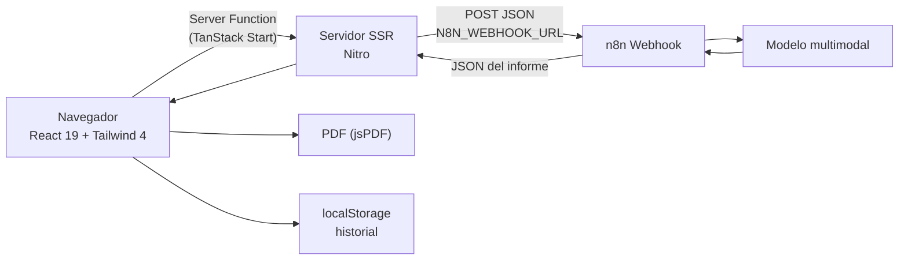

# PRL Vision Audit

Aplicación web para técnicos de Prevención de Riesgos Laborales (PRL) que convierte la fotografía de un puesto de trabajo en un **informe técnico de evaluación de riesgos** con hallazgos clasificados, normativa aplicable, medidas correctivas, plazos y responsables.

> Herramienta de apoyo a la decisión. **No sustituye** la evaluación de riesgos ni el criterio de un Técnico Superior en PRL.

---

## Índice

- [El problema](#el-problema)
- [Funcionalidades](#funcionalidades)
- [Arquitectura](#arquitectura)
- [Contrato de datos](#contrato-de-datos)
- [Escala de riesgo (criterio INSST)](#escala-de-riesgo-criterio-insst)
- [Puesta en marcha](#puesta-en-marcha)
- [Variables de entorno](#variables-de-entorno)
- [Configuración de n8n](#configuración-de-n8n)
- [Scripts](#scripts)
- [Despliegue](#despliegue)
- [Seguridad y privacidad](#seguridad-y-privacidad)
- [Testing y calidad](#testing-y-calidad)
- [Limitaciones y hoja de ruta](#limitaciones-y-hoja-de-ruta)
- [Descargo de responsabilidad](#descargo-de-responsabilidad)

---

## El problema

En una inspección de seguridad, el técnico de PRL fotografía la situación, la describe a mano y después, ya en oficina, redacta el informe consultando normativa dispersa (Ley 31/1995, RD 39/1997, RD 1215/1997, RD 773/1997, RD 485/1997, RD 486/1997…). Es un proceso lento, repetitivo y propenso a olvidos: se documenta el hallazgo pero no siempre se cita la norma, el plazo o el responsable de la corrección.

**PRL Vision Audit** reduce esa fricción a una foto y dos campos:

1. El técnico hace la foto en obra y añade el área y una observación rápida.
2. El análisis multimodal devuelve los hallazgos tipificados (acto inseguro / condición insegura) con su nivel de riesgo.
3. El informe se revisa, se ajusta y se exporta como **acta PDF** o como **texto formateado para Word/correo**.

El objetivo no es automatizar la decisión, sino **llegar al informe con el 80 % del trabajo documental hecho**.

---

## Funcionalidades

- **Captura Mobile-First**: cámara o galería, con vista previa y validación de formato y tamaño (JPG, PNG, WebP, HEIC; máx. 15 MB).
- **Análisis multimodal**: la imagen se reduce en el dispositivo y se envía a un flujo de n8n que la procesa con un modelo de visión.
- **Informe editable**: cada hallazgo se puede reescribir y el nivel de riesgo se puede corregir con un clic. La última palabra la tiene el técnico.
- **Exportación a PDF**: acta con cabecera corporativa, bloque de datos, evidencia fotográfica, tabla de hallazgos paginada y espacios de firma.
- **Exportación a Word/correo**: copia enriquecida (HTML + texto plano) con fallback para navegadores sin Clipboard API.
- **Historial local**: hasta 30 inspecciones en `localStorage`, con recuento por nivel de riesgo y borrado individual o total.
- **Datos de ejemplo**: permite evaluar la interfaz sin configurar el webhook. El PDF generado con datos de ejemplo lleva marca de agua y no es válido como acta.

---

## Arquitectura



### Decisiones de diseño

| Decisión                                                        | Motivo                                                                                                                                                      |
| --------------------------------------------------------------- | ----------------------------------------------------------------------------------------------------------------------------------------------------------- |
| La URL del webhook vive en el **servidor**, no en el cliente    | Evita CORS en n8n y evita publicar la URL. Se lee con `process.env.N8N_WEBHOOK_URL`.                                                                        |
| La imagen se **redimensiona en el navegador** antes de enviarse | Ahorra ancho de banda en obra y mantiene el payload por debajo del límite del webhook.                                                                      |
| El informe se **normaliza** en el cliente                       | n8n puede devolver objeto, array, string JSON o envoltorios (`output`, `data`, `json`…). `normalizeInforme()` acepta todas las formas y valida el contrato. |
| El **PDF se genera en el navegador**                            | No hay almacenamiento de datos personales en servidor; jsPDF se carga en diferido para no penalizar el primer render.                                       |
| El **historial es local**                                       | El técnico trabaja desde su dispositivo; no se requiere cuenta ni base de datos.                                                                            |

### Estructura del código

```
src/
├─ routes/
│  ├─ __root.tsx            # shell, metadatos, 404 y error boundary
│  └─ index.tsx             # flujo principal (captura → análisis → informe)
├─ components/
│  ├─ audit/
│  │  ├─ AppHeader.tsx      # cabecera y acceso al historial
│  │  ├─ PhotoDropzone.tsx  # cámara/galería, arrastrar y soltar
│  │  ├─ ReportPanel.tsx    # informe, exportación y edición del técnico
│  │  ├─ FindingCard.tsx    # tarjeta de hallazgo
│  │  └─ HistoryPanel.tsx   # historial en un sheet lateral
│  └─ ui/                   # primitivas shadcn/ui
├─ lib/
│  ├─ webhook.functions.ts  # Server Function: proxy al webhook + SSRF + timeout
│  ├─ report.ts             # contrato, normalización, escala de riesgo, export
│  ├─ pdf.ts                # acta PDF con jsPDF
│  ├─ image.ts              # Base64/miniatura en el navegador
│  └─ history.ts            # persistencia y saneado del historial
└─ styles.css               # Tailwind v4 + tokens del design system
```

---

## Contrato de datos

### Petición (cliente → servidor → n8n)

```json
{
  "imagen_base64": "<JPEG 1600 px, sin prefijo data:>",
  "area": "Taller de soldadura",
  "observaciones": "Operario cortando metal sin pantalla facial"
}
```

### Respuesta esperada (n8n → servidor → cliente)

```json
{
  "resumen_general": "Se identifican 2 hallazgos…",
  "hallazgos": [
    {
      "titulo": "Operario cortando metal sin pantalla facial",
      "tipo": "Acto Inseguro",
      "nivel_riesgo": "Importante",
      "normativa": "RD 773/1997, art. 3 y Anexo III",
      "medida_correctiva": "Paralizar la tarea y dotar de pantalla facial EN 166…",
      "plazo": "Inmediato",
      "responsable": "Encargado de taller"
    }
  ]
}
```

`normalizeInforme()` tolera además:

- la respuesta envuelta en un array (`[{ … }]`),
- el JSON serializado como string, incluso con vallas ` ```json `,
- envoltorios `output`, `json`, `data`, `body`, `result` o `text`,
- texto adicional alrededor del objeto JSON.

Si la respuesta no encaja, se muestra un mensaje en español y **no** se pinta un informe vacío.

---

## Escala de riesgo (criterio INSST)

La app traduce la escala de cinco niveles del INSST a un semáforo de tres colores para que la lectura en obra sea inmediata:

| Nivel INSST                | Semáforo en la app | Color |
| -------------------------- | ------------------ | ----- |
| Trivial                    | Bajo               | Verde |
| Tolerable                  | Bajo               | Verde |
| Moderado                   | Medio              | Ámbar |
| Importante                 | Alto               | Rojo  |
| Intolerable / No aceptable | Alto               | Rojo  |

La clasificación se calcula en `riskLevel()` (`src/lib/report.ts`) y está cubierta por tests, incluido el caso `Intolerable`, que contiene la subcadena `Tolerable` y no debe degradarse a verde.

---

## Puesta en marcha

### Requisitos

- Node.js **20 o superior** (probado con Node 24 y npm 11).
- Una instancia de n8n con un flujo de análisis multimodal, o los datos de ejemplo para probar la interfaz.

### Instalación

```bash
git clone <url-del-repositorio>
cd prl-vision-safety-audit

# Opción A: npm (genera/usa package-lock.json)
npm install

# Opción B: Bun (lockfile canónico del proyecto: bun.lock)
bun install
```

### Configuración

```bash
cp .env.example .env
# Edita .env y define N8N_WEBHOOK_URL
```

### Desarrollo

```bash
npm run dev
```

La app queda disponible en la URL que Vite muestre en la terminal (por defecto `http://localhost:5173`; en el sandbox de Lovable, `http://localhost:8080`).

---

## Variables de entorno

| Variable            | Obligatoria | Ámbito   | Descripción                                                                   |
| ------------------- | ----------- | -------- | ----------------------------------------------------------------------------- |
| `N8N_WEBHOOK_URL`   | Sí          | Servidor | URL completa del webhook de n8n.                                              |
| `N8N_WEBHOOK_TOKEN` | No          | Servidor | Si el webhook exige autenticación, se envía en la cabecera `x-webhook-token`. |

### Por qué `N8N_WEBHOOK_URL` y no `VITE_N8N_WEBHOOK_URL`

Vite expone al bundle del navegador **cualquier** variable que empiece por `VITE_`. Si la URL del webhook se llamara `VITE_N8N_WEBHOOK_URL`:

- quedaría escrita en el JavaScript público y cualquiera podría invocarla;
- permitiría consumir la cuota del modelo de IA o inyectar peticiones;
- rompería el aislamiento que justifica usar una Server Function.

Por eso el código lee `process.env.N8N_WEBHOOK_URL` en el servidor y el valor nunca llega al cliente. El build está verificado: el bundle público no contiene `N8N_WEBHOOK_URL` ni `n8n.cloud`.

En local, Nitro carga `.env` y `.env.local` en `process.env`. En producción, define la variable en el panel del proveedor (Vercel → _Settings → Environment Variables_).

---

## Configuración de n8n

1. Crea un flujo con un nodo **Webhook** en método `POST`, ruta `prl-audit` y autenticación según tu caso.
2. Añade el nodo de modelo multimodal (OpenAI, Anthropic, Google…). Envíale `imagen_base64` como imagen y `area` / `observaciones` como contexto.
3. Termina con un nodo **Respond to Webhook** que devuelva el JSON del contrato anterior.
4. En el nodo Webhook, selecciona **Respond: Using “Respond to Webhook” Node**.

Prompt de sistema recomendado para el nodo de IA:

```text
Eres un Técnico Superior en Prevención de Riesgos Laborales en España.
Analiza la imagen de un puesto de trabajo y devuelve EXCLUSIVAMENTE un JSON válido,
sin texto adicional ni bloques de código, con esta forma:

{
  "resumen_general": "string",
  "hallazgos": [
    {
      "titulo": "string",
      "tipo": "Acto Inseguro | Condición Insegura",
      "nivel_riesgo": "Trivial | Tolerable | Moderado | Importante | Intolerable",
      "normativa": "referencia legal concreta (ley, real decreto, artículo y anexo)",
      "medida_correctiva": "medida técnica y verificable",
      "plazo": "Inmediato | 24 horas | 1 semana | 1 mes",
      "responsable": "rol responsable de la corrección"
    }
  ]
}

Reglas:
- Cita normativa española vigente y comprobable. Si no estás seguro de la referencia,
  indica el real decreto principal y evita inventar artículos.
- No inventes elementos que no se vean en la imagen.
- Si no hay riesgos evidentes, devuelve "hallazgos": [] y explícalo en el resumen.
- Escribe en español de España.
```

> El endpoint `/` de la app comprueba si la variable está configurada y muestra un aviso discreto si no lo está. Un fallo en esa comprobación **no bloquea** el análisis.

---

## Scripts

| Comando             | Qué hace                                                     |
| ------------------- | ------------------------------------------------------------ |
| `npm run dev`       | Servidor de desarrollo.                                      |
| `npm run build`     | Build de producción (target por defecto: Cloudflare module). |
| `npm run preview`   | Sirve el build generado.                                     |
| `npm run lint`      | ESLint + Prettier.                                           |
| `npm run typecheck` | `tsc --noEmit` con `strict` y sin variables sin usar.        |
| `npm run check`     | `typecheck` + `lint` + `test`.                               |
| `npm run format`    | Prettier sobre todo el repo.                                 |
| `npm test`          | Suite de Vitest.                                             |

---

## Despliegue

### Vercel (recomendado)

El proyecto se construye con **Nitro** y Vercel detecta el preset automáticamente:

1. Importa el repositorio en Vercel.
2. Framework preset: **Other** (Nitro genera la salida).
3. Añade `N8N_WEBHOOK_URL` en _Settings → Environment Variables_ (entorno Production y Preview).
4. Build command: `npm run build`.

Para reproducir el build de Vercel en local:

```bash
# PowerShell
$env:NITRO_PRESET="vercel"; npm run build

# bash
NITRO_PRESET=vercel npm run build
```

La salida se genera en `.vercel/output` (ignorada por Git).

> **Duración de las funciones**: el análisis multimodal puede tardar. La petición usa un timeout de 180 s; si tu plan de Vercel limita la función por debajo, considera acortar el prompt, reducir la imagen o mover la espera a un patrón asíncrono (webhook de callback + sondeo).

### Lovable

El proyecto está conectado a Lovable y su lockfile canónico es `bun.lock`. Los cambios empujados a la rama conectada se sincronizan en el editor. No reescribas el historial publicado (force push, rebase o amend de commits ya empujados).

### Cloudflare

`npm run build` genera la salida para Workers/Pages. Define `N8N_WEBHOOK_URL` como secreto del Worker (`wrangler secret put`).

---

## Seguridad y privacidad

- **Sin secretos en el repositorio.** `.gitignore` excluye `.env` y `.env.*`; solo se versiona `.env.example` sin valores.
- **Sin secretos en el bundle.** La URL del webhook se lee solo en el servidor. Verificado sobre la salida de build.
- **Protección SSRF.** El servidor rechaza esquemas distintos de HTTP(S) y destinos en loopback, rangos privados (`10/8`, `172.16/12`, `192.168/16`, `169.254/16`) y equivalentes IPv6.
- **Límite de respuesta.** Se cortan las respuestas de más de 5 MB para evitar agotar memoria.
- **Sin logs del contenido.** No se registran ni el payload de la inspección ni el cuerpo de la respuesta. Los detalles técnicos solo aparecen en desarrollo.
- **Protección CSRF.** `createCsrfMiddleware` protege las Server Functions.
- **Datos en el dispositivo.** La imagen se reduce a 1600 px y se re-codifica como JPEG antes de enviarse. El historial (máx. 30 inspecciones) vive en `localStorage` y se puede vaciar desde la propia interfaz.
- **Marca de agua en informes de ejemplo.** Evita que un PDF de demostración se firme como acta real.

### Dependencias

`npm audit --omit=dev` informa de dos avisos heredados del stack:

| Paquete       | Aviso                                                             | Alcance real                                                              |
| ------------- | ----------------------------------------------------------------- | ------------------------------------------------------------------------- |
| `vite` 8.1.5  | Vulnerabilidades del servidor de desarrollo de Vite               | Solo afecta a `npm run dev`; el build de producción son assets estáticos. |
| `zod` 3.25.76 | Consumo de memoria al validar colecciones acotadas de gran tamaño | El esquema solo valida cadenas con `.max()`; no usa colecciones acotadas. |

Remediación pendiente cuando el ecosistema lo permita: `npm i zod@^4.6.7 vite@^8.3.8` y regenerar `bun.lock`. Se pospone para no desincronizar el lockfile que usa Lovable.

---

## Testing y calidad

```bash
npm run check
```

Cobertura actual:

- `riskLevel`: escala INSST completa, incluido `Tolerable` → verde e `Intolerable` → rojo.
- `normalizeInforme`: objeto, array, string JSON, envoltorios anidados y errores legibles.
- `loadHistorial`: descarta entradas corruptas, valida fechas y sobrevive a JSON inválido.
- Enrutado: `/` resuelve a la ruta de índice.

**Estado verificado del repositorio**: `typecheck` sin errores, `lint` sin errores ni avisos, 16 tests en verde, build de producción y build de Vercel correctos.

### Estandarización

- `.gitattributes` con `* text=auto eol=lf` para que Windows no reintroduzca CRLF.
- `.editorconfig` con UTF-8, LF y sangría de 2 espacios.
- Prettier + ESLint con `@typescript-eslint/no-unused-vars` activo.
- `package-lock.json` generado con npm; `bun.lock` se mantiene como lockfile de Lovable.

---

## Limitaciones y hoja de ruta

- **No es una evaluación de riesgos legal.** Es un borrador asistido; requiere revisión y firma de un técnico competente.
- **El modelo puede alucinar normativa.** El prompt pide referencias comprobables, pero la cita debe verificarse antes de firmar.
- **HEIC**: Safari lo decodifica; otros navegadores pueden no hacerlo. La app muestra instrucciones para convertir a JPG.
- **Un solo idioma**: español de España.
- **Historial local**: no se sincroniza entre dispositivos y se pierde al limpiar el navegador.
- **Componentes shadcn sin usar**: 34 de 46 primitivas no se importan. No afectan al bundle final (tree-shaking), pero engordan el repositorio; se pueden podar.
- **Hoja de ruta**: autenticación y almacenamiento en Supabase, firma digital del acta, plantillas por sector (construcción, logística, hostelería), exportación a DOCX y comparación entre inspecciones.

---

## Descargo de responsabilidad

Esta aplicación es una **herramienta de apoyo técnico**. Los informes generados son borradores que deben ser revisados, corregidos y validados por un Técnico Superior en Prevención de Riesgos Laborales antes de su uso oficial. El autor no se responsabiliza del uso que se haga del contenido generado ni de las decisiones adoptadas a partir de él.
