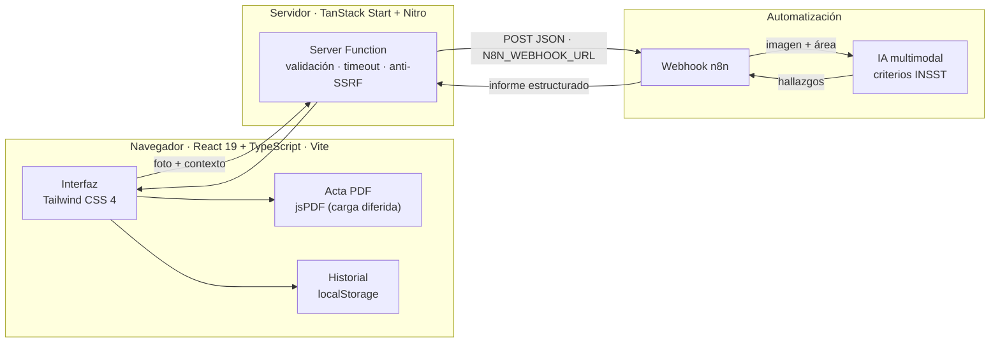

# Caso de estudio · PRL Vision Audit

## De una foto en obra a un acta técnica revisable

**Resumen ejecutivo:** aplicación web mobile-first que convierte la fotografía de un puesto de trabajo en un borrador de evaluación de riesgos conforme al criterio INSST, con normativa española, medidas correctivas y acta PDF. El técnico conserva la decisión final; la herramienta elimina el trabajo documental repetitivo.

|              |                                                                                  |
| ------------ | -------------------------------------------------------------------------------- |
| **Rol**      | Producto, arquitectura frontend, auditoría técnica y endurecimiento de seguridad |
| **Stack**    | React 19 · TypeScript 5 · Vite 8 · Tailwind CSS 4 · TanStack Start · n8n · jsPDF |
| **Tipo**     | Aplicación web mobile-first para inspecciones de PRL                             |
| **Estado**   | Versión 1.0 · build de producción y build de Vercel verificados                  |
| **Licencia** | MIT                                                                              |

---

## Contexto

En una inspección de Prevención de Riesgos Laborales, el técnico fotografía la situación, toma notas y, ya en oficina, reconstruye lo que vio para redactar el informe. Debe citar la norma correcta, proponer una medida verificable, asignar un plazo y un responsable. Es un trabajo de alto valor técnico con una carga administrativa desproporcionada.

El cuello de botella no es la inspección: es la traducción posterior de la evidencia en un documento defendible. Ahí se pierden horas, se olvidan referencias y se retrasa la entrega del acta.

## El problema

- **Fragmentación.** Fotos en el móvil, notas en papel o en una libreta, normativa consultada en paralelo.
- **Repetición.** Cada informe vuelve a redactar hallazgos y medidas similares.
- **Riesgo de omisión.** Un hallazgo sin norma, plazo o responsable es un informe débil.
- **Contexto de uso adverso.** La captura ocurre de pie, con guantes, con prisa y con conectividad irregular.

## Mi rol y el punto de partida

El punto de partida fue un prototipo funcional generado con Lovable. Mi trabajo no consistió en añadir pantallas sobre ese borrador, sino en **auditarlo y llevarlo a estándares de producción**: revisar la capa de servidor, corregir el criterio de negocio, endurecer la seguridad, añadir pruebas y dejar el repositorio en un estado mantenible.

Esa decisión es parte del caso: usar un scaffold para acelerar la validación es razonable; entregarlo sin auditoría, no.

## Objetivos de diseño

1. **Captura sin fricción:** una foto, un área y una observación breve.
2. **Rigor antes que volumen:** cada hallazgo debe poder defenderse con normativa y una medida concreta.
3. **Control humano:** el técnico edita, corrige y firma; la IA no decide.
4. **Privacidad por diseño:** sin cuentas, sin base de datos y sin enviar la URL del webhook al navegador.

## La solución en 30 segundos

El técnico abre la app en el móvil, hace o sube una foto y describe el área. La imagen se reduce en el dispositivo y se envía a un flujo de n8n que la analiza con un modelo multimodal. El resultado vuelve normalizado como una lista de hallazgos con tipo, nivel de riesgo, normativa, medida correctiva, plazo y responsable.

El técnico revisa el borrador, ajusta lo que haga falta y exporta:

- un **acta PDF** con evidencia fotográfica, tabla paginada y espacios de firma;
- o un **informe en HTML y texto plano** para pegarlo en Word o en el correo.

## Arquitectura

La decisión estructural es que **el navegador nunca conoce la URL del webhook**. El cliente invoca una Server Function de TanStack Start; el servidor lee `N8N_WEBHOOK_URL` de `process.env`, valida la petición y reenvía la inspección. Esto elimina CORS, protege la credencial y permite aplicar controles que en el cliente serían eludibles.

## Decisiones que marcan el proyecto

| Decisión                                                      | Motivo                                                         | Contrapartida asumida                                         |
| ------------------------------------------------------------- | -------------------------------------------------------------- | ------------------------------------------------------------- |
| Proxy en servidor en lugar de llamar a n8n desde el navegador | La URL deja de ser pública y desaparecen los problemas de CORS | Una función de servidor que hay que desplegar y monitorizar   |
| Redimensionar y recodificar la imagen en el cliente           | Menos datos en obra y payloads predecibles                     | Pérdida controlada de calidad en la evidencia                 |
| Normalizar la respuesta del webhook                           | n8n puede devolver objeto, array, string JSON o envoltorios    | Más código de validación que hay que testear                  |
| Historial en `localStorage`                                   | Sin cuentas ni datos personales en servidor                    | No se sincroniza entre dispositivos                           |
| Generar el PDF en el navegador                                | Ningún dato del acta sale del dispositivo                      | jsPDF se carga en diferido para no penalizar el primer render |
| Semáforo de tres colores sobre la escala INSST                | Lectura inmediata en obra sin perder los cinco niveles         | Hay que documentar bien la equivalencia                       |

## Seguridad: el secreto no se publica

La auditoría encontró un riesgo clásico: la tentación de llamar “variable de frontend” a la URL del webhook. Se eliminó cualquier fallback a `VITE_N8N_WEBHOOK_URL`; con ese prefijo, Vite habría incrustado la URL en el JavaScript público.

Controles aplicados:

- Validación de la URL con `new URL()` y comprobación de protocolo.
- Guarda anti-SSRF: loopback, rangos privados, link-local y equivalentes IPv6.
- Timeout de 180 segundos y tope de respuesta de 5 MB con lectura por streaming.
- Sin registro del payload ni del cuerpo de respuesta; solo el estado HTTP.
- Token opcional de webhook mediante cabecera, sin exponerlo al cliente.
- Verificación del bundle publicado: la URL no aparece en los assets del navegador.

## Rigor de dominio: la escala INSST

La app traduce los cinco niveles del INSST a un semáforo de tres colores para que la lectura en campo sea inmediata:

| Nivel INSST | Semáforo | Lectura                     |
| ----------- | -------- | --------------------------- |
| Trivial     | Verde    | Aceptable                   |
| Tolerable   | Verde    | Aceptable                   |
| Moderado    | Ámbar    | Requiere acción planificada |
| Importante  | Rojo     | Requiere acción prioritaria |
| Intolerable | Rojo     | No admite demora            |

Un detalle que parece menor y no lo es: `Intolerable` contiene la subcadena `Tolerable`. Un mapeo ingenuo lo habría degradado a verde. La lógica comprueba primero los niveles altos y está cubierta por tests, incluido ese caso.

## UX pensada para obra

- Captura desde cámara **o** galería: se eliminó `capture="environment"`, que en muchos móviles ocultaba la galería.
- Formatos JPG, PNG, WebP y HEIC, con límite explícito de 15 MB.
- Si el navegador no puede decodificar un HEIC, el mensaje explica cómo convertir la foto en lugar de fallar en silencio.
- Validación de tipo y tamaño antes de procesar, para no gastar datos ni tiempo.
- Protección contra miniaturas fuera de orden: una foto lenta no sobrescribe la más reciente.
- Estados de carga accesibles (`aria-busy`), botones con etiqueta y errores en español.
- Un fallo al comprobar el estado del servicio **no bloquea** el análisis.

## Calidad verificable

El repositorio se normalizó y se dejó en verde antes de publicarlo:

- `typecheck` estricto, con `noUnusedLocals` y `noUnusedParameters`.
- ESLint y Prettier sin errores ni avisos.
- 16 tests en 3 archivos: escala INSST completa, normalización de respuestas y saneado del historial.
- Build de producción y build de Vercel correctos.
- Bundle de cliente auditado: sin URL de webhook ni referencias al dominio de n8n.
- Historial que descarta entradas corruptas en lugar de romper la interfaz.

## Resultados

| Resultado                                                | Evidencia                                                      |
| -------------------------------------------------------- | -------------------------------------------------------------- |
| El técnico pasa de reconstruir el informe a revisarlo    | Flujo foto ➔ borrador ➔ edición ➔ PDF                          |
| El webhook no queda expuesto                             | El bundle público no contiene la URL                           |
| Los hallazgos son defendibles                            | Normativa, medida, plazo y responsable por hallazgo            |
| El acta es presentable                                   | PDF con evidencia, metadatos y espacios de firma               |
| Los informes de ejemplo no se confunden con actas reales | Marca de agua “DATOS DE EJEMPLO · NO VÁLIDO COMO ACTA OFICIAL” |
| El repositorio es mantenible                             | Tests, tipos estrictos y lint limpio                           |

No hay métricas de producción porque el proyecto no se ha desplegado con usuarios reales. El impacto esperado es cualitativo: **trasladar el esfuerzo del técnico de la redacción a la validación**.

## Origen y evolución

El primer prototipo se generó con Lovable para validar el flujo. La versión actual reescribe la capa de servidor, corrige el mapeo de riesgos, añade pruebas automatizadas, normaliza el repositorio y refuerza accesibilidad y privacidad. El historial de commits refleja esa evolución y no se ha reescrito para ocultarla.

## Limitaciones y siguiente iteración

- **No sustituye una evaluación de riesgos legal.** El acta es un borrador que debe validar un Técnico Superior en PRL.
- **El modelo puede alucinar normativa.** El prompt exige referencias comprobables, pero la cita debe verificarse antes de firmar.
- **HEIC depende del navegador.** Safari lo decodifica; otros pueden requerir conversión.
- **Historial local.** No se sincroniza y se pierde al limpiar el navegador.
- **Despliegue.** El build de Vercel está preparado; falta publicar la demo y definir la URL final.
- **Siguiente iteración.** Autenticación y almacenamiento en Supabase, firma digital del acta, plantillas por sector y exportación DOCX.

## Qué demuestra este proyecto

1. **Criterio de producto:** identificar que el valor no está en generar texto, sino en reducir la distancia entre la evidencia y un documento firmable.
2. **Rigor de dominio:** entender la escala INSST y sus trampas, no solo pintar badges de colores.
3. **Seguridad aplicada:** mover un secreto al servidor, bloquear SSRF y verificar el bundle en lugar de confiar en la intención.
4. **Calidad sostenible:** tests, tipos estrictos y un repositorio legible para la siguiente persona.
5. **Honestidad técnica:** reconocer el origen del prototipo y documentar qué se reescribió.

---

**Demo:** pendiente de publicación en Vercel · **Código:** [github.com/carladdm/prl-vision-safety-audit](https://github.com/carladdm/prl-vision-safety-audit) · **Licencia:** MIT
